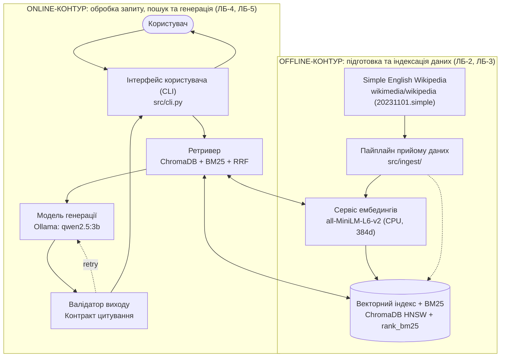

# CS-SimpleWiki RAG (`rag-project-kryvoshapko`)

Наскрізний навчальний проєкт із дисципліни «Технології розробки гібридних систем штучного інтелекту» (ХНУРЕ, кафедра ПІ, магістерський рівень, спеціальність F2 «Інженерія програмного забезпечення»).

Автор: Кривошапко Сергій Сергійович, гр. ІПЗм-26-2.

---

## Опис сценарію використання

CS-SimpleWiki RAG – це локальна консольна система генерації, доповненої пошуком (Retrieval-Augmented Generation), призначена для студентів спеціальності «Інженерія програмного забезпечення» та розробників-початківців (junior software engineers). Система надає швидкі, стислі та фактично обґрунтовані англомовні відповіді на запитання з основ комп'ютерних наук (алгоритми, структури даних, мережі, операційні системи, бази даних, мови програмування, вебтехнології) з обов'язковим цитуванням ідентифікаторів фрагментів корпусу (`[chunk_id]`) та чесною відмовою за відсутності релевантної інформації в базі знань.

### Корпус даних
- назва: тематична підмножина Simple English Wikipedia «Комп'ютерні науки та інформаційні технології» (Computer Science & IT);
- джерело: набір [`wikimedia/wikipedia`](https://huggingface.co/datasets/wikimedia/wikipedia) на Hugging Face Hub, конфігурація `20231101.simple`;
- ліцензія: відкрита ліцензія CC BY-SA 4.0 / GFDL, що дозволяє вільне повторне розповсюдження;
- цільовий обсяг: 1 000–1 500 документів (орієнтовно 2 500–4 000 чанків по 300 слів із перекриттям 15%).

---

## Обраний технологічний стек (безкоштовний)

| Компонент | Обране рішення | Призначення |
|---|---|---|
| Мова програмування | Python 3.12 (сумісність із 3.10+) | Реалізація пайплайну, CLI та тестів |
| Векторне сховище | ChromaDB (локальний persistent-режим) + `rank_bm25` | HNSW-векторний індекс, зберігання метаданих і BM25 для RRF |
| Модель ембедингів | `sentence-transformers/all-MiniLM-L6-v2` | Локальна векторизація чанків і запитів на CPU (384 виміри) |
| Модель генерації | `qwen2.5:3b` через Ollama | Локальна генерація відповідей із цитуванням без платних API |

---

## Архітектура системи



Детальна схема збережена у [docs/architecture.png](docs/architecture.png) та [docs/architecture.mmd](docs/architecture.mmd).

---

## Структура репозиторію

```text
rag-project-kryvoshapko/
├── config/
│   └── settings.yaml        # параметри корпусу, чанкування, моделей і ретривера
├── docs/
│   ├── architecture.mmd     # вихідний код архітектурної діаграми (Mermaid)
│   └── architecture.png     # контекстна архітектурна діаграма системи
├── reports/
│   └── lab-1/               # звіт до лабораторної роботи № 1 (PDF)
├── src/
│   ├── ingest/              # прийом, очищення та чанкування даних (ЛБ-2)
│   ├── embeddings/          # векторизація та побудова індексу ChromaDB (ЛБ-3)
│   ├── retrieval/           # щільний, BM25 та гібридний пошук RRF (ЛБ-4)
│   ├── generation/          # промпти, виклик Ollama та валідація цитат (ЛБ-4)
│   └── eval/                # скрипти оцінювання та тестування (ЛБ-3, ЛБ-5)
├── tests/                   # оцінювальні набори та поведінкові тести (ЛБ-3, ЛБ-5)
├── requirements.txt         # залежності Python
└── README.md                # опис проєкту та інструкція встановлення
```

---

## Інструкція із встановлення та налаштування стеку

### 1. Клонування репозиторію та створення віртуального середовища Python

Вимоги: версія Python 3.10+ (рекомендовано Python 3.12), 8–16 ГБ RAM, ~4 ГБ вільного місця на диску.

Windows (PowerShell):
```powershell
git clone https://github.com/NureKryvoshapkoSerhii/rag-project-kryvoshapko.git
cd rag-project-kryvoshapko
python -m venv .venv
.venv\Scripts\Activate.ps1
```

macOS / Linux:
```bash
git clone https://github.com/NureKryvoshapkoSerhii/rag-project-kryvoshapko.git
cd rag-project-kryvoshapko
python3 -m venv .venv
source .venv/bin/activate
```

### 2. Встановлення Python-залежностей

```bash
python -m pip install --upgrade pip
pip install -r requirements.txt
```

Модель ембедингів `sentence-transformers/all-MiniLM-L6-v2` завантажиться автоматично з Hugging Face Hub під час першого запуску скрипту векторизації (ЛБ-3).

### 3. Встановлення Ollama та завантаження локальної LLM

1. Завантажте та встановіть Ollama з офіційного сайту: https://ollama.com/download
2. Перевірте роботу сервісу та завантажте модель генерації `qwen2.5:3b` (~2 ГБ):

```bash
ollama --version
ollama pull qwen2.5:3b
ollama run qwen2.5:3b "Explain what a hash table is in one sentence."
```

---

## Етапи виконання проєкту (теґи релізів)

- `lab-1` – проєктування ПЗ: сценарій використання, вибір корпусу та стеку, архітектурна діаграма, ініціалізація репозиторію;
- `lab-2` – збір, очищення, чанкування корпусу та `data-card.md` (заплановано);
- `lab-3` – ембединги, векторний індекс ChromaDB та вимірювання `Recall@k` (заплановано);
- `lab-4` – гібридний пошук (ChromaDB + BM25 + RRF), генерація через Ollama, контракт цитування та CLI (заплановано);
- `lab-5` – оцінювання, поведінкові й метаморфні тести, перевірка ін'єкцій промпта (заплановано).
