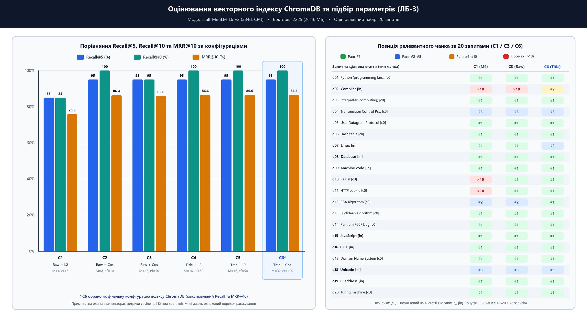

# Звіт до лабораторної роботи № 3: Векторні представлення даних (`CS-SimpleWiki RAG`)

Автор: Кривошапко Сергій Сергійович, гр. ІПЗм-26-2  
Репозиторій: [`rag-project-kryvoshapko`](https://github.com/NureKryvoshapkoSerhii/rag-project-kryvoshapko) (теґ `lab-3`)

---

## 1. Обрана модель ембедингів та обґрунтування

Для векторизації корпусу обрано компактну попередньо навчену модель **`sentence-transformers/all-MiniLM-L6-v2`** (бібліотека `sentence-transformers`, запуск на CPU):

- **розмірність вектора:** 384 (float32);
- **обсяг моделі:** ~22.7 млн параметрів (~90 МБ на диску, 6-шаровий трансформер MiniLM);
- **ліцензія та вартість:** Apache 2.0, 100% локальне та безкоштовне використання без API-ключів;
- **швидкість на CPU:** усі 2 225 чанків корпусу кодуються за **34.48 с** (~64.5 чанків/с), а одиночний запит обробляється за ~4–15 мс;
- **чому саме вона:** порівняно з `bge-small-en-v1.5` (~133 МБ) та `e5-small-v2` (вимагає спеціальних префіксів `query:`/`passage:`), `all-MiniLM-L6-v2` є найпростішим, легким і добре перевіреним базовим рішенням для англомовного корпусу Simple English Wikipedia, при цьому вбудований шар нормалізації видає одиничні вектори, зручні для косинусної подібності.

---

## 2. Статистика побудованого векторного індексу ChromaDB

Індекс побудовано скриптом `src/embeddings/build_index.py` у persistent-режимі ChromaDB (`data/chroma_db/`, виключено з Git у `.gitignore`). Разом із кожним вектором збережено текст чанка та всі метадані з ЛБ-2 (`doc_id`, `chunk_index`, `title`, `url`, `word_count`, `char_count`).

| Показник | Значення |
|---|---|
| Векторне сховище / тип індексу | ChromaDB 1.5.9 (HNSW) |
| Назва колекції | `cs_simplewiki_chunks` |
| Кількість векторів у індексі | **2 225** |
| Розмірність векторів | **384** |
| Формат тексту для кодування | `"{title}\n{text}"` (`prepend_title: true`, `normalize_embeddings: true`) |
| Метрика відстані | `cosine` |
| Параметри HNSW | `M = 32`, `construction_ef = 200`, `search_ef = 100` |
| Час кодування корпусу (CPU) | 34.48 с (64.5 чанків/с) |
| Час запису в ChromaDB | 2.93 с |
| Розмір індексу на диску (`data/chroma_db/`) | **26.46 МБ** (27 740 990 байт) |

Склад каталогу `data/chroma_db/`: `chroma.sqlite3` (22.87 МБ – тексти, метадані, таблиці сегментів), `data_level0.bin` (3.44 МБ – вектори та нижній рівень графа HNSW), `index_metadata.pickle` (123 КБ), `link_lists.bin` (16.4 КБ), `length.bin` (7.8 КБ), `header.bin` (100 Б).

> **Інженерна примітка (Windows):** на Windows C++-бібліотека `hnswlib` у складі ChromaDB не створює бінарні файли індексу, якщо шлях містить кирилицю. Для стабільної роботи в будь-якому каталозі додано утиліту `resolve_chroma_path()`, яка на Windows перетворює не-ASCII шлях на короткий ASCII-шлях (8.3) через `GetShortPathNameW`.

---

## 3. Оцінювальний набір (`tests/eval-set.jsonl`)

Сформовано вручну **20 пар «запит – релевантний чанк»** (`tests/eval-set.jsonl`) за 20 різними статтями корпусу CS & IT:

- **12 початкових чанків (`c000`):** Python, Interpreter, TCP, UDP, Hash table, Pascal, HTTP cookie, RSA algorithm, Euclidean algorithm, Pentium F00F bug, DNS, Turing machine;
- **8 внутрішніх чанків (`c001`/`c002`):** Compiler (лексичний аналізатор і парсер), Linux (історія назви Freax та перехід на GPL), Database (теорема CAP), Machine code (інструкції процесора і байткод Java), JavaScript (`var` в ES5 проти `let`/`const`), C++ (ручне керування пам'яттю), Unicode (UTF-8/UTF-16), IP address (unicast/multicast та BOOTP).

Запити сформульовано природною англійською мовою, наближено до реальних питань студента, без надмірного дублювання рідкісних термінів (наприклад, без слів `Freax`, `F00F`, `BOOTP` чи `CAP theorem` у формулюваннях).

---

## 4. Результати вимірювань `Recall@5`, `Recall@10` та підбору параметрів

Скрипт `src/eval/eval_retrieval.py` порівняв 6 конфігурацій параметрів (варіювалися `prepend_title`, метрики `l2`/`ip`/`cosine` та параметри HNSW `M`, `construction_ef`, `search_ef`):

| Код | Конфігурація | Recall@5 | Recall@10 | Doc Recall@5 | MRR@10 | Сер. запит (мс) |
|---|---|---:|---:|---:|---:|---:|
| `C1` | Raw text + `l2` (`M=4, ef_c=16, ef_s=5`) | 85.0% (17/20) | 85.0% (17/20) | 90.0% | 0.7583 | 2.30 |
| `C2` | Raw text + `cosine` (`M=8, ef_c=32, ef_s=10`) | 95.0% (19/20) | 100.0% (20/20) | 100.0% | 0.8639 | 2.35 |
| `C3` | Raw text + `cosine` (`M=16, ef_c=100, ef_s=50`) | 95.0% (19/20) | 95.0% (19/20) | 100.0% | 0.8583 | 2.34 |
| `C4` | Title+text + `l2` (`M=16, ef_c=100, ef_s=50`) | 95.0% (19/20) | 100.0% (20/20) | 100.0% | 0.8655 | 2.34 |
| `C5` | Title+text + `ip` (`M=16, ef_c=100, ef_s=50`) | 95.0% (19/20) | 100.0% (20/20) | 100.0% | 0.8655 | 2.65 |
| **`C6`** | **Title+text + `cosine` (`M=32, ef_c=200, ef_s=100`)** | **95.0% (19/20)** | **100.0% (20/20)** | **100.0%** | **0.8655** | **2.70** |

### Ключові спостереження
1. **Вплив параметрів HNSW:** при занижених `M=4, ef_s=5` (`C1`) наближений пошук втрачає 3 запити (`q02`, `q10`, `q11`), знижуючи `Recall@5` до 85.0%. Підвищення параметрів графа до `M=16..32` і `ef_s=50..100` усуває промахи HNSW при затримці <3 мс на запит.
2. **Вплив заголовка статті (`prepend_title=True`):** додавання заголовка перед текстом чанка витягнуло внутрішній чанк `simplewiki_3742_c001` (`Compiler`, `q02`) із промаху (`>10` у `C3`) на 7-му позицію (`Recall@10` виріс із 95.0% до **100.0%**) та підняло `RSA algorithm` (`q12`) з #2 на #1.
3. **Еквівалентність метрик на одиничних векторах:** оскільки `all-MiniLM-L6-v2` повертає L2-нормалізовані вектори, `cosine`, `ip` і `l2` на достатніх параметрах HNSW дають однаковий порядок ранжування (`C4`, `C5`, `C6`). Обрано `cosine` (`C6`) через зручну інтерпретацію подібності `1 - distance`.
4. **Заділ для ЛБ-4:** єдиний запит поза топ-5 у фінальному індексі – `q02` (внутрішній чанк `Compiler c001`, ранг #7), оскільки перший чанк `Compiler c000` і суміжні статті перехоплюють верхні позиції. Це підтверджує доцільність поєднання щільного пошуку з лексичним BM25 через RRF у наступній лабораторній роботі.

---

## 5. Перевірка CLI-скрипту пошуку (`src/embeddings/search.py`)

Нижче наведено топ-1 результати для 5 демонстраційних запитів (`python -m src.embeddings.search --demo`):

| № | Запит | Топ-1 `chunk_id` | Стаття (чанк) | Подібність |
|---|---|---|---:|---:|
| 1 | `How does TCP make sure network packets arrive in the right order?` | `simplewiki_151618_c000` | Transmission Control Protocol (0) | 0.5711 |
| 2 | `How does a hash table use a hash function for fast lookup?` | `simplewiki_348971_c000` | Hash table (0) | 0.7368 |
| 3 | `What is the difference between var, let, and const in JavaScript?` | `simplewiki_20871_c002` | JavaScript (2) | 0.5926 |
| 4 | `What three guarantees are described by Eric Brewer's CAP theorem?` | `simplewiki_39657_c002` | Database (2) | 0.4890 |
| 5 | `How do public and private keys work in asymmetric RSA encryption?` | `simplewiki_29060_c000` | RSA algorithm (0) | 0.6541 |

Усі 8 модульних та інтеграційних тестів (`python -m unittest discover -s tests -v`) пройдено успішно.
